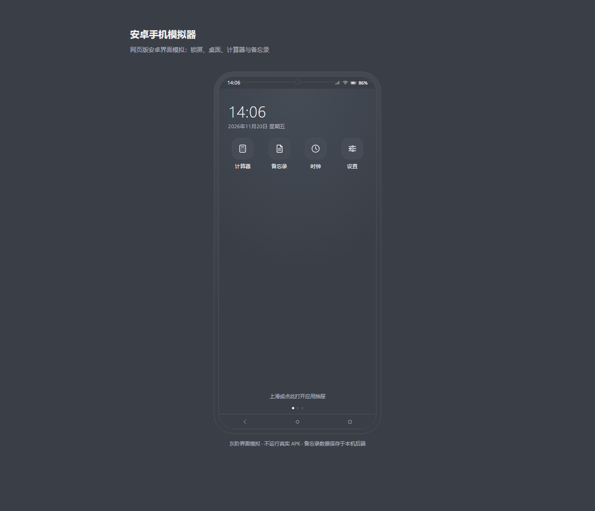
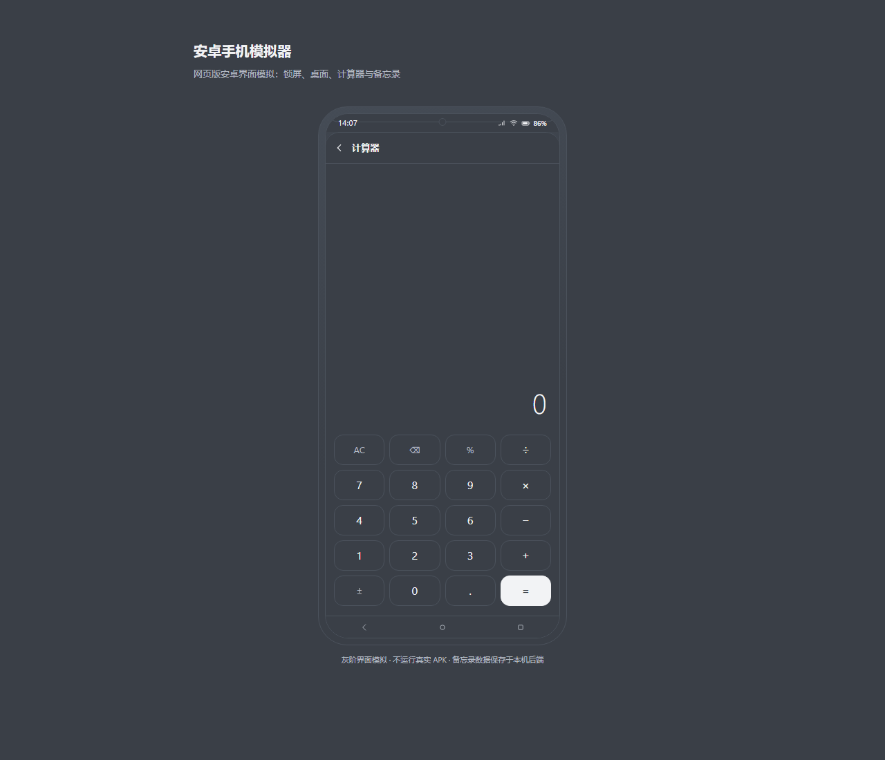
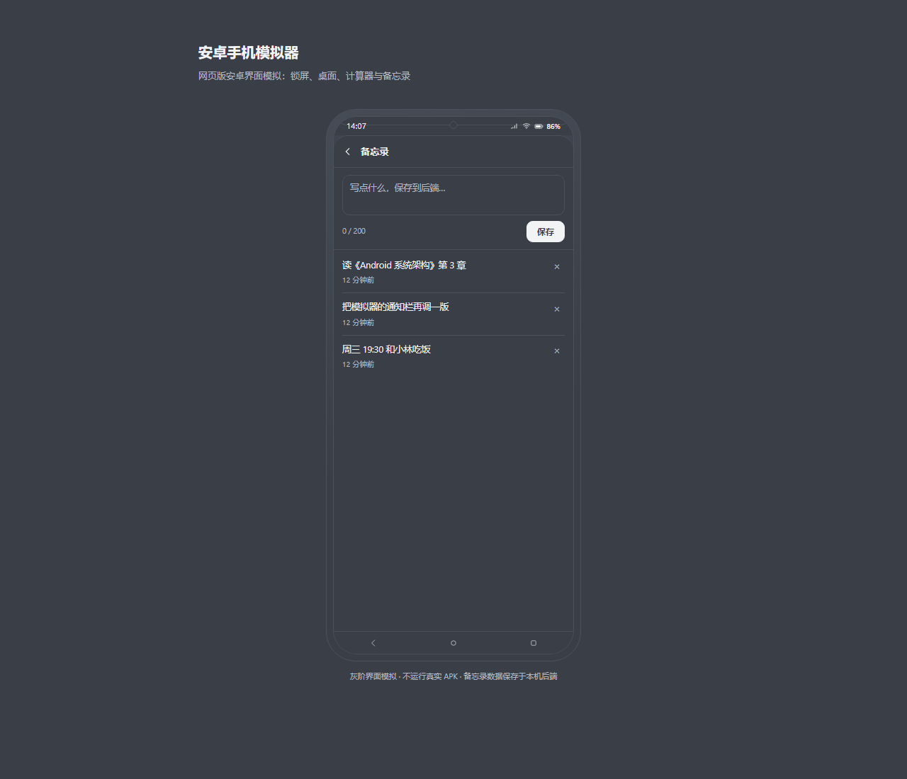
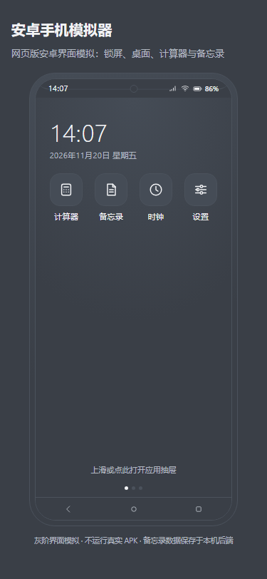

# 安卓手机模拟器

> 网页版安卓手机界面模拟器：在浏览器里模拟手机系统界面与内置应用，**不运行真实 APK**。

`Python 3.10+` · `零第三方依赖` · `零构建（build: none）` · `MIT License`

**在线地址：** <https://wkeeli.cn/phone/>

站点由**全站 Basic Auth** 保护，访问时需使用站点账号 `wkeeli` 登录（密码由站点管理员维护，本仓库不含密码）。
应用内部没有独立登录页，认证完全由网关负责。

## 截图

| 桌面 | 计算器 |
| --- | --- |
|  |  |

| 备忘录 | 375px 移动端 |
| --- | --- |
|  |  |

## 功能

| 模块 | 说明 |
| --- | --- |
| 锁屏 | 显示时间与日期，上滑或点击解锁 |
| 桌面 | 灰阶壁纸 + 4 个内置应用图标；上滑或点按钮打开应用抽屉 |
| 应用抽屉 | 列出内置应用；相机、相册、音乐、电话、短信、浏览器、文件、地图等未内置应用点击后给出提示 |
| 计算器 | 四则运算即时计算、AC 与退格、支持键盘输入 |
| 备忘录 | 列表 / 新建 / 删除，数据经后端 SQLite 持久化 |
| 时钟 | 当前时间日期 + 秒表（开始 / 暂停 / 重置） |
| 设置 | 设备信息（来自 `api/device`）、锁屏、重新加载 |
| 通知栏 | 下拉或点击状态栏打开；快捷开关 Wi-Fi / 蓝牙 / 勿扰 / 飞行 + 通知卡片 |
| 三键导航 | 返回 / 主屏 / 最近任务（最近任务为最小实现：仅提示未实现） |
| 状态栏 | 实时时间、信号、Wi-Fi、电池 |
| 响应式 | 桌面端居中显示手机外壳；375px 宽下无横向滚动 |

## 技术栈

| 层 | 选型 | 说明 |
| --- | --- | --- |
| 后端 | Python 3.10+ 标准库 | `http.server` + `sqlite3`，单文件 `app.py`，无第三方依赖、无需 pip |
| 前端 | 原生 HTML + CSS + JavaScript | 零依赖、零构建，无框架、无 CDN、无网络字体 |
| 存储 | SQLite | 备忘录持久化，默认 `./data/`，生产 `/var/lib/phone-sim` |
| 部署 | systemd + Caddy | 应用机 systemd 常驻服务；网关机 Caddy 以 `handle_path /phone/*` 子路径反向代理 |

## 目录结构

```
phone-sim/
├── app.py                    # 后端：Python 标准库单文件（http.server + sqlite3）
├── index.html                # 页面骨架：锁屏 / 桌面 / 应用抽屉 / 通知栏 / 手机外壳
├── style.css                 # 灰阶单主题样式，仅使用 :root 中 5 个变量
├── app.js                    # 前端交互（原生 JS，无框架）
├── favicon.svg               # 站点图标（本地 SVG，无外链）
├── tests/
│   └── test_app.py           # 后端单元测试（unittest，临时目录隔离数据）
├── deploy/
│   ├── phone-sim.service     # systemd 单元（运行用户、环境文件、StateDirectory、加固）
│   ├── caddy-phone-sim.conf  # 网关机 Caddyfile 片段（/phone/ 子路径反代）
│   ├── DEPLOY.md             # 完整部署手册（含验证、排错、数据备份）
│   └── deploy.sh             # 本地一键更新脚本（Git Bash）
├── docs/
│   └── screenshots/          # README 截图
│       ├── home.png
│       ├── calculator.png
│       ├── notes.png
│       └── mobile.png
├── README.md
├── LICENSE
├── .gitattributes            # 统一 LF 行尾，避免 Windows 开发 / Linux 部署差异
└── .gitignore
```

## 本地运行

```bash
git clone https://github.com/wzqfwanj/phone-sim.git
cd phone-sim
python app.py
```

然后浏览器打开 <http://127.0.0.1:8140> 。默认监听 `0.0.0.0:8140`，数据写入 `./data/`。

Linux / macOS 或需要改配置时：

```bash
HOST=127.0.0.1 PORT=9000 DATA_DIR=./.tmp-data APP_TZ=Asia/Shanghai python app.py
```

只在本机使用时建议把 `HOST` 设为 `127.0.0.1`，避免监听全部网卡。

## 配置

| 环境变量 | 默认值 | 说明 |
| --- | --- | --- |
| `HOST` | `0.0.0.0` | 监听地址 |
| `PORT` | `8140` | 监听端口 |
| `DATA_DIR` | `./data` | SQLite 数据目录（生产为 `/var/lib/phone-sim`） |
| `APP_TZ` | `Asia/Shanghai` | 后端时间/日期时区 |

## 接口

| 方法 | 路径 | 说明 |
| --- | --- | --- |
| GET | `/` | 返回 `index.html` 页面 |
| GET | `/style.css` | 样式表 |
| GET | `/app.js` | 前端脚本 |
| GET | `/favicon.svg` | 站点图标 |
| GET | `/api/health` | 健康检查，成功返回 200 |
| GET | `/api/device` | 设备信息 JSON |
| GET | `/api/notes` | 备忘录列表 |
| POST | `/api/notes` | 新建备忘录，JSON 请求体 `{"text": "..."}`，文本 1~200 字 |
| DELETE | `/api/notes/<id>` | 删除指定备忘录 |

请求示例：

```bash
curl -s http://127.0.0.1:8140/api/health
curl -s http://127.0.0.1:8140/api/device
curl -s -X POST http://127.0.0.1:8140/api/notes \
     -H 'Content-Type: application/json' \
     -d '{"text":"第一条备忘录"}'
curl -s http://127.0.0.1:8140/api/notes
curl -s -X DELETE http://127.0.0.1:8140/api/notes/1
```

前端所有资源与 API 均使用**相对路径**（如 `app.js`、`api/notes`，不带前导 `/`），
因此应用可以直接挂在任意子路径下，生产环境即 `https://wkeeli.cn/phone/`，无需修改代码。

## 测试

后端单元测试基于标准库 `unittest`，无需额外依赖：

```bash
python -m unittest discover -s tests -v
```

## 部署

生产部署由两部分组成：应用机用 systemd 常驻 `app.py`，网关机用 Caddy 把
`https://wkeeli.cn/phone/` 反向代理到应用机 `8140` 端口。

完整步骤（环境准备、用户与目录、环境变量、systemd、Caddy 路由、线上验证、日志排错、
升级、数据备份、常见问题）见 **[deploy/DEPLOY.md](deploy/DEPLOY.md)**。

| 文件 | 用途 |
| --- | --- |
| [deploy/phone-sim.service](deploy/phone-sim.service) | systemd 单元：`phonesim` 用户、`/etc/phone-sim.env`、`/var/lib/phone-sim` 数据目录、基础加固 |
| [deploy/caddy-phone-sim.conf](deploy/caddy-phone-sim.conf) | 网关机 Caddyfile 片段：`redir` + `handle_path /phone/*` + `reverse_proxy` |
| [deploy/DEPLOY.md](deploy/DEPLOY.md) | 完整部署手册 |
| [deploy/deploy.sh](deploy/deploy.sh) | 本地一键发布：git push → git archive 打包 → scp 到应用机解压重启 → 网关探测 `/phone/` |

一键更新（本地 Windows Git Bash）：

```bash
bash deploy/deploy.sh
```

## 开发约束符合性

- **灰阶单主题**：`:root` 只定义 `--bg`、`--fg`、`--muted`、`--line`、`--hover` 五个变量；
  无浅色/深色切换，无主题切换按钮。
- **零依赖、零构建、零外链**：后端仅用 Python 标准库（无需 pip）；前端原生 HTML/CSS/JS
  （无包管理器、无打包步骤）；页面不引用任何 CDN、第三方脚本、网络字体或外部图片，
  `favicon.svg` 为本地 SVG。
- **JavaScript 的使用理由**：锁屏上滑/点击解锁、应用抽屉、计算器即时计算与键盘输入、
  备忘录增删、秒表、通知栏下拉、最近任务提示等都需要交互与状态管理，纯 HTML/CSS 无法完成，
  因此引入一份原生 `app.js`；不使用任何框架。
- **响应式**：桌面端居中呈现手机外壳；375px 宽下无横向滚动。
- **标题**：浏览器 `<title>` 与页面主标题均为「安卓手机模拟器」；页面 `.sub` 用一句话说明定位。
- **数据持久化**：备忘录经后端 SQLite 持久化（开发默认 `./data/notes.db`，生产
  `/var/lib/phone-sim/notes.db`），刷新页面或重启服务不丢失。

## 许可证

[MIT License](LICENSE) © 2026 wzqfwanj
